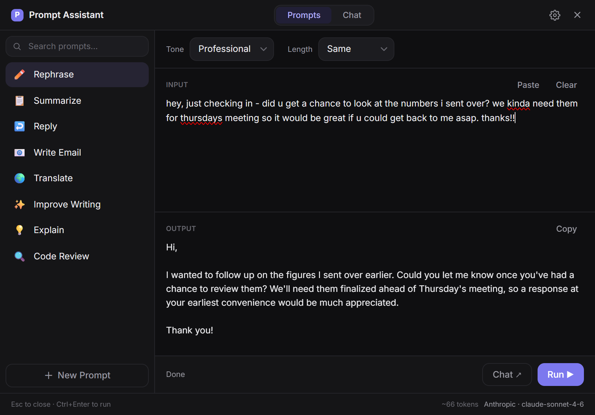
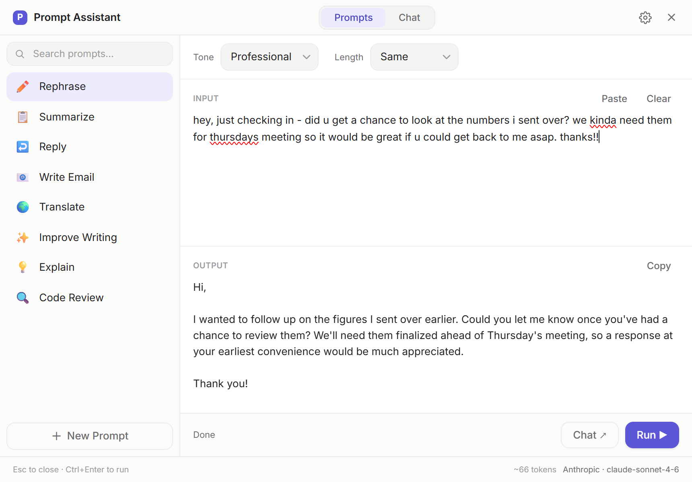
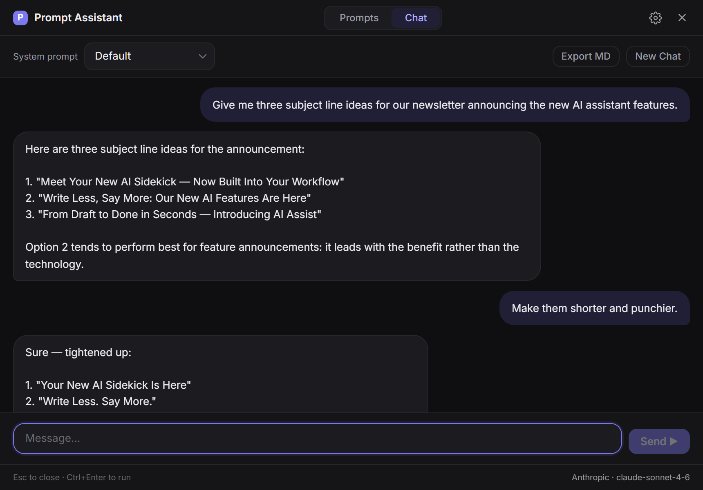
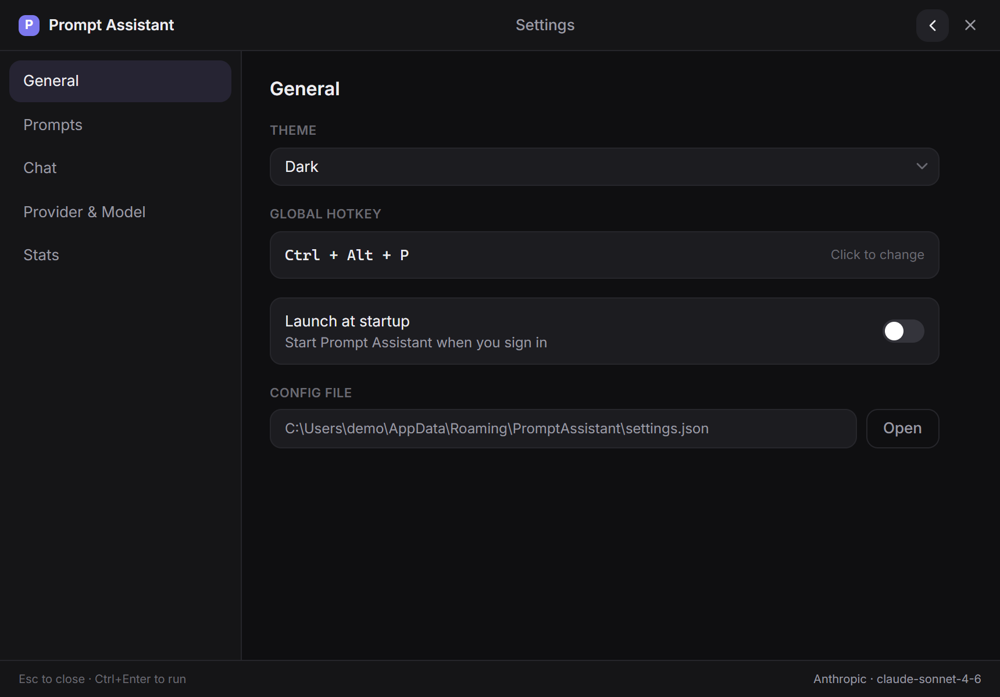

<div align="center">

# Prompt Assistant

**Your AI text sidekick, one hotkey away — in any Windows app.**

Select text anywhere, press `Ctrl+Alt+P`, pick a prompt, and paste the result straight back.
Local-first, provider-agnostic, and open source.



</div>

---

## What is it?

Prompt Assistant is a lightweight Windows tray app that brings AI text processing to **every** application — email, browser, IDE, Office, chat tools. It captures your selected text through a global hotkey, runs it through a prompt template ("recipe") with your chosen AI provider, streams the result, and can paste it right back where you were working.

No subscription, no account, no cloud middleman: you bring your own API key (or run fully local with Ollama), and everything is stored on your machine.

## Demonstration

**Fix a sloppy email before sending** — select the draft, hit the hotkey, choose *Rephrase* with tone *Professional*:



**Brainstorm iteratively in the Chat tab** — full conversations with system-prompt presets, exportable to Markdown:



**Configure everything in-app** — provider & model, a click-to-record global hotkey, launch at startup, usage stats:



## Features

- **Global hotkey** (`Ctrl+Alt+P` by default, click-to-record any combination) — captures the selected text from the active window
- **Prompt recipes** — 8 built-in (Rephrase, Summarize, Reply, Write Email, Translate, Improve Writing, Explain, Code Review) plus unlimited custom ones with parameters
- **5 AI providers** — Anthropic (Claude), OpenAI, OpenRouter (any model), Ollama (fully local), GitHub Copilot (device-flow login)
- **Streaming responses** with cancel, token estimate, and one-click **Insert back** into the source app or **Copy**
- **Chat tab** — multi-turn conversations, system-prompt presets, continue any prompt result as a chat, export to Markdown
- **Clean minimal UI** — light & dark theme, crisp typography, single instance, instant open (pre-warmed)
- **Local & private** — settings in one hand-editable JSON file, API keys encrypted with Windows DPAPI, no telemetry

## How it works

```
┌─ any Windows app ──────┐        ┌─ Prompt Assistant (tray) ─────────────────┐
│  select text           │        │                                            │
│  press Ctrl+Alt+P ─────┼───────►│  1. captures selection via clipboard      │
│                        │        │  2. popup opens with text pre-filled      │
│                        │        │  3. recipe + parameters build the prompt  │
│                        │        │  4. streams from your AI provider         │
│  result pasted back ◄──┼────────│  5. Insert ↩ / Copy / continue in Chat    │
└────────────────────────┘        └────────────────────────────────────────────┘
```

Under the hood it's a hybrid app: a small **C# / .NET 10 host** owns the Windows integration (tray icon, global hotkey, selection capture, paste-back, encrypted settings, streaming HTTP), while the entire UI is **React + Tailwind rendered in WebView2** — which is where the crisp, modern look comes from.

```
PromptAssistant/
├── App.xaml.cs                  — tray icon, hotkey, single-instance, popup lifecycle
├── Models/                      — Recipe, AppSettings, ChatMessage, …
├── Services/
│   ├── AiService.cs             — streaming completions for all 5 providers
│   ├── WebBridge.cs             — C# ↔ JavaScript message bridge
│   ├── ClipboardService.cs      — selection capture & paste-back
│   ├── HotkeyService.cs         — Win32 RegisterHotKey
│   └── …                        — settings, encryption, stats, model catalog, Copilot auth
├── Views/PopupWindow.xaml.cs    — borderless WebView2 host window
└── frontend/                    — React + TypeScript + Tailwind UI (Vite)
```

## Getting started

### Requirements

- Windows 10 or 11
- [.NET 10 Desktop Runtime](https://dotnet.microsoft.com/download/dotnet/10.0) — if it's missing, the app prompts you to install it on first launch
- WebView2 Runtime — preinstalled on Windows 11 and virtually all updated Windows 10 machines
- Node.js 20+ (only for building from source)

### Build from source

```powershell
git clone <this repo>
cd PromptAssistant
dotnet build -c Release        # also builds the React frontend automatically
```

### Publish a distributable version

```powershell
dotnet publish -c Release -r win-x64 --self-contained false -p:PublishSingleFile=true -p:IncludeNativeLibrariesForSelfExtract=true -o publish
```

Copy the resulting `publish/` folder (a single small exe + the `wwwroot` UI folder) anywhere you like and run `PromptAssistant.exe`.

## Provider setup

| Provider | Setup |
|---|---|
| **Anthropic** | Settings → Provider & Model → paste your key from [console.anthropic.com](https://console.anthropic.com/) |
| **OpenAI** | Paste your key from [platform.openai.com](https://platform.openai.com/api-keys) |
| **OpenRouter** | Paste your key from [openrouter.ai/keys](https://openrouter.ai/keys), then ↻ Refresh to load every available model |
| **Ollama** | Install [Ollama](https://ollama.com/), `ollama pull llama3` — the app auto-discovers installed models at `http://localhost:11434` |
| **GitHub Copilot** | Click *Login with GitHub*, enter the one-time code in your browser (requires an active Copilot subscription) |

API keys never leave your machine and are stored DPAPI-encrypted in the config file.

## Custom prompts

Create prompts from the popup (*＋ New Prompt*) or Settings → Prompts. Template syntax:

- `{input}` — the selected / typed text
- `{param:Name}` — replaced with the user's choice for that parameter

Recipes live in `%APPDATA%\PromptAssistant\settings.json` as plain JSON, so you can bulk-edit, back up, or share prompt packs:

```json
{
  "id": "my-commit-msg",
  "name": "Commit Message",
  "icon": "📝",
  "systemPrompt": "You are a git commit message writer. Write a concise conventional commit message.",
  "userPromptTemplate": "Write a git commit message for these changes.\nStyle: {param:Style}\n\nDiff:\n{input}",
  "parameters": [
    { "name": "Style", "options": ["feat", "fix", "refactor", "docs", "chore"], "defaultValue": "feat" }
  ]
}
```

## Keyboard shortcuts

| Shortcut | Action |
|---|---|
| `Ctrl+Alt+P` | Open / toggle the popup from anywhere (configurable) |
| `Ctrl+Enter` | Run the selected prompt |
| `Enter` | Send chat message (`Shift+Enter` for a new line) |
| `Esc` | Close the popup |

## Development

The UI can be developed without the C# host — the frontend ships a mock bridge with sample data and simulated streaming:

```bash
cd frontend
npm run dev        # opens on http://localhost:5173 in any browser
```

`dotnet build` wires everything together automatically (`npm install` + Vite build + copy to output). Use `-p:SkipFrontendBuild=true` for a C#-only build.

## License

[MIT](LICENSE)
